# Range Control VR

A shooting range for Meta Quest where you run the range as well as shoot on it. Pick one of five guns from the rack, then set target distance, speed, spawn rate and movement from a control panel at your booth and watch the range change while you do it.

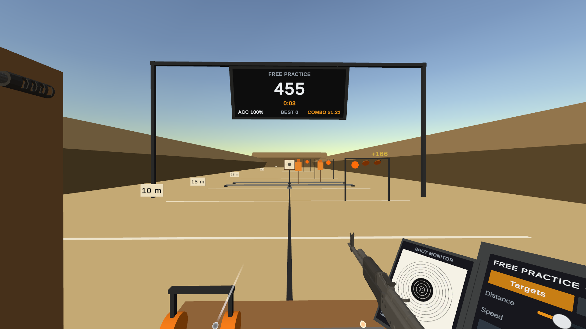

<p align="center"><sub>Screenshots were captured in the Unity Editor. The guns in them are posed by a script, so there are no hands on them.</sub></p>

**[Download the APK](https://github.com/Alihamxamalik/VR-Shooting-Range/releases/latest)** · Version 0.1.0 · Built with Unity 6, the XR Interaction Toolkit and OpenXR

> This is an early build. Three modes are playable, the range is a blockout of simple shapes and every sound is a synthesised placeholder. It has been built and tested in the Unity Editor and has not had its tuning pass on a headset yet, so expect rough edges in how the guns sit in the hand. See [Roadmap](#roadmap).

## Contents

- [What you do](#what-you-do)
- [The guns](#the-guns)
- [The control panel](#the-control-panel)
- [Targets, modes and scoring](#targets-modes-and-scoring)
- [Controls](#controls)
- [Comfort and accessibility](#comfort-and-accessibility)
- [Install on your headset](#install-on-your-headset)
- [About this build](#about-this-build)
- [For developers](#for-developers)
- [Roadmap](#roadmap)
- [Credits](#credits)
- [Licence](#licence)

## What you do

Pick a gun, set the range, shoot a round, read the result, change one thing and go again. A round lasts 30 to 90 seconds, so a session is many small experiments: faster targets, a longer distance, another gun.

There are no enemies, only paper, steel and wood. You stand in one booth and never move through the world: the rack is at your left hand, the bench in front of you and the control panel at your right.

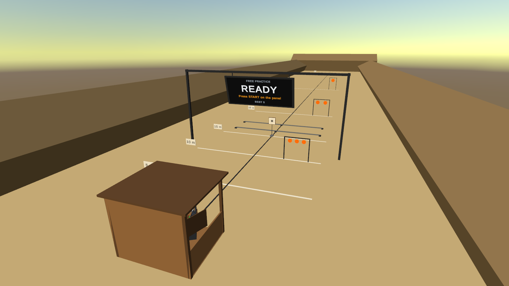

## The guns

Five guns, each chosen to show a different VR mechanic.

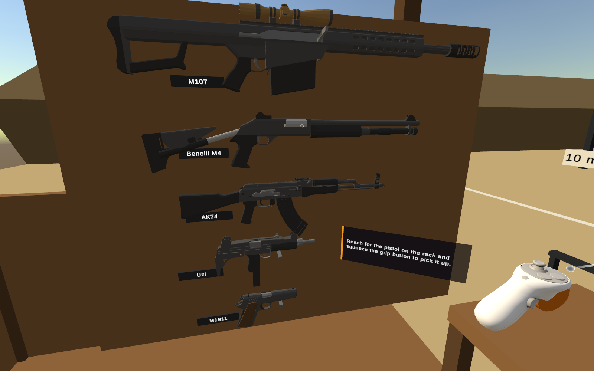

| Gun | Fire | Magazine | Grip | What it shows off |
| --- | --- | --- | --- | --- |
| M1911 | Semi | 7 | One hand | Slide locks back on empty and has to be released after a reload |
| Uzi | Auto | 32 | One or two hands | Sustained fire, recoil climb, spread that opens up in a burst |
| AK74 | Semi / auto | 30 | Two hands | Two-handed aiming and a fire selector |
| Benelli M4 | Semi, 8 pellets | 7 shells | Two hands | Pellet spread, loaded one shell at a time |
| M107 | Semi | 10 | Two hands | A working scope, with the range opened out to 100 m |

Every number that makes one gun differ from another lives in a `WeaponData` asset:

| Gun | Rounds / min | Spread cone | Muzzle climb | Kick back | Haptic strength |
| --- | --- | --- | --- | --- | --- |
| M1911 | 400 (cap) | 0.3° | 6° | 3 cm | 0.95 |
| Uzi | 600 | 1.2°, opening to 3.7° | 2° | 1 cm | 0.5 |
| AK74 | 650 | 0.6°, opening to 2.6° | 3° | 2 cm | 0.7 |
| Benelli M4 | 240 | 3.5° pellet cone | 10° | 5 cm | 1.0 |
| M107 | 60 | 0.05° | 12° | 6 cm | 1.0 |

### Handling

- **Grab** a gun by its grip and it snaps into the hand at the right angle. Let go and it hangs where you left it, then floats back to the rack after two seconds, so nobody bends down to the floor.
- **Trigger** fires at 80% pull and re-arms below 30%, which stops a twitchy finger from doubling.
- **Two hands**: a second hand on a long gun steadies it. The aim then follows the line between the hands, and recoil drops by 40%.
- **Recoil** moves the gun only, never the camera. The shot is traced from the muzzle as recoil has left it, so muzzle climb really costs accuracy in a burst.
- **Reload** by hand: B or Y drops the magazine, a fresh one comes from the tray on the bench or the pouch on your belt, and you push it into the well. A quick-reload option does it with one button press for anyone who just wants to shoot.

### The scope

The M107's scope is a second camera rendering into a small texture on the lens. It only renders while your eye is within 25 cm of the eyepiece; the rest of the time the lens shows still glass, which protects frame time on the headset. It is zeroed at 75 m, and while the rifle is in your hands the range opens out from 50 m to 100 m.

<p align="center">
  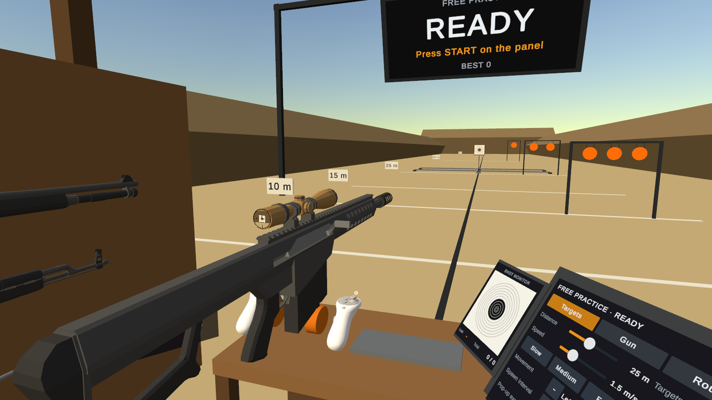
  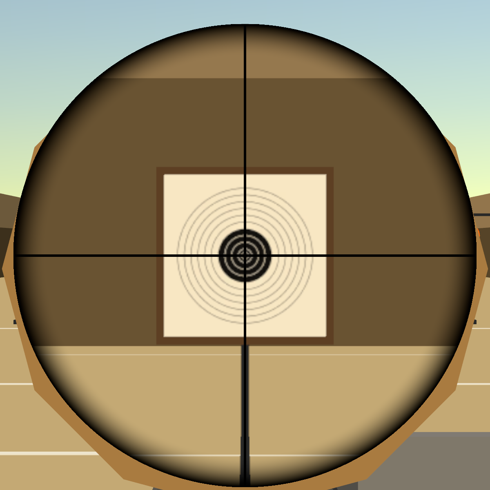
</p>
<p align="center"><em>The M107 at the bench, and the same paper target through its scope.</em></p>

## The control panel

The signature feature. Every change on the panel shows on the range at once: the paper carrier drives to the new distance, the rails slide with it and targets take the new speed mid-flight.

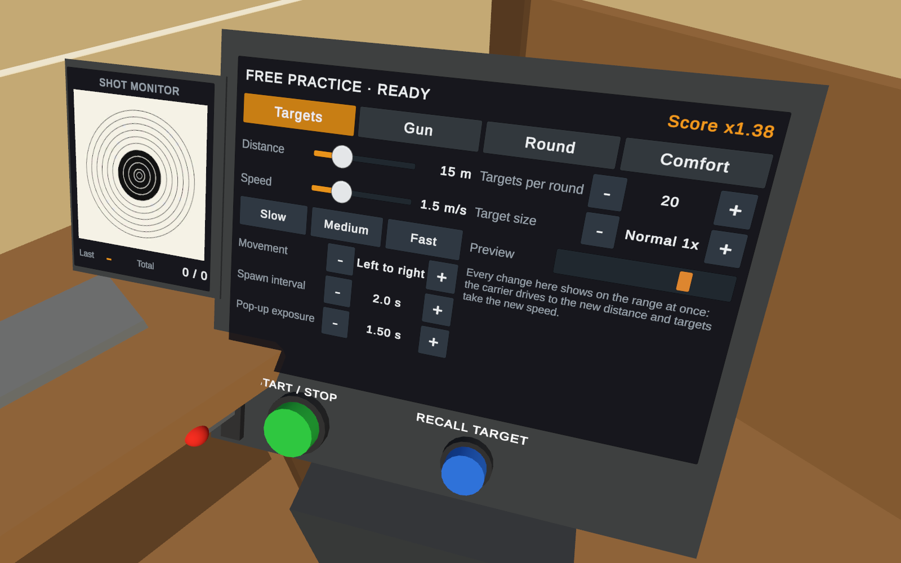

| Setting | Range | Default | What it changes |
| --- | --- | --- | --- |
| Target distance | 5 to 50 m (100 m with the M107) | 15 m | Where targets stand or travel; the paper carrier drives there live |
| Target speed | 0 to 6 m/s, with Slow, Medium and Fast presets | 1.5 m/s | How fast targets move along the rails |
| Movement | Static, Left to right, Ping-pong, Strafe, Pop-up | Left to right | How each target moves |
| Spawn interval | 0.5 to 5 s | 2 s | Time between targets |
| Pop-up exposure | 0.5 to 3 s | 1.5 s | How long a pop-up stays up |
| Targets per round | 5 to 50, or Endless | 20 | When a round ends |
| Target size | 0.7x, 1x, 1.5x | 1x | Difficulty and accessibility |
| Fire rate | 50 to 150% of the gun's own | 100% | Rate of automatic fire; the cap for semi-automatic |
| Infinite ammo | On / Off | Off | Skips reloading |
| Laser sight | On / Off | Off | A beam from the muzzle, for learning to aim |
| Round timer | Off, 30, 60, 90 s | Off | Round length in Free Practice |

The buttons and sliders are pressed with a fingertip, with a ray as the fallback, and Start / Stop and Recall are physical buttons on the console. The Round tab picks the mode and holds three preset slots that save and load a full setup.

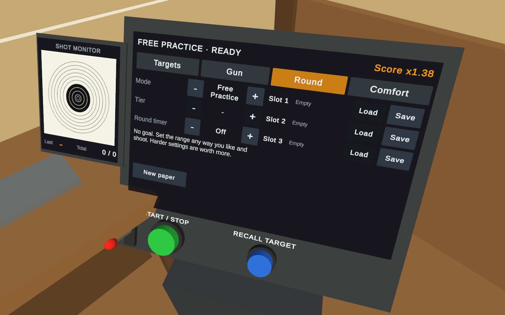

**Fairness rule.** Challenge modes lock the panel to fixed settings so scores stay comparable. Free Practice unlocks everything and multiplies the score by a difficulty factor instead, shown live in the corner of the panel.

## Targets, modes and scoring

| Target | Behaviour | Points |
| --- | --- | --- |
| Paper bullseye | Hangs on the carrier; ten scoring rings; holes stay on the paper | 1 to 10 by ring; the inner X breaks ties |
| Steel plate | Swings back when hit and settles after 1.5 s | 100 |
| Moving silhouette | Travels on a rail at the panel's speed and flips down when hit | 100, head 150 |
| Pop-up | Rises for the exposure time and drops if missed | 100 plus up to 100 for reaction time |
| No-shoot | White with a black X, mixed in with the others | -250, and the combo is lost |

A hit in a row multiplies the next by 1.1, up to 2x. A miss resets the combo.

In Free Practice the multiplier is `clamp(distance / 15 m, 0.5, 3) x (1 + speed / 4 m/s) x size`, where size is 1.3 for small targets, 1.0 for normal and 0.8 for large.

| Mode | Goal | Length | Settings |
| --- | --- | --- | --- |
| Free Practice | A sandbox for every setting | Until you stop it, or the round timer | Everything unlocked |
| Moving Gallery | Hit as many moving targets as you can; leave the no-shoots alone | 60 s | Slow, Medium or Fast tier, each with its own best score |
| Precision | Ten shots at paper, scored by ring and by group size | 10 shots, no timer | 10, 25 or 50 m |

Every round ends the same way: a results card on the scoreboard with score, accuracy, medal and personal best.

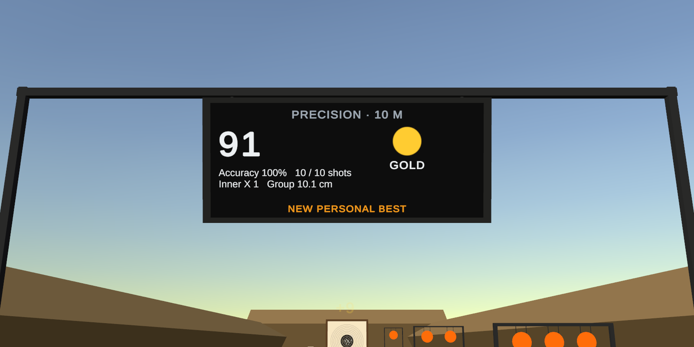

At 50 m a bullet hole is a few pixels, so hits are also shown at the booth. A shot monitor on the console plots each shot on a mini target, like the electronic scoring at a real range, and the Recall button brings the paper back to the booth to read the group up close.

| Shot monitor | Recalled paper |
| --- | --- |
| 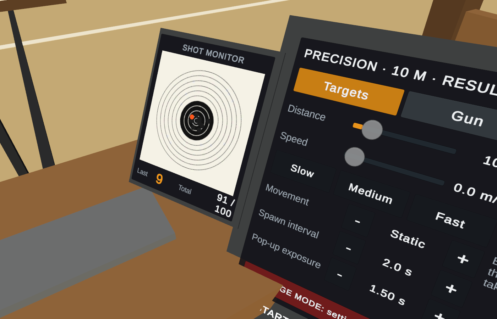 | 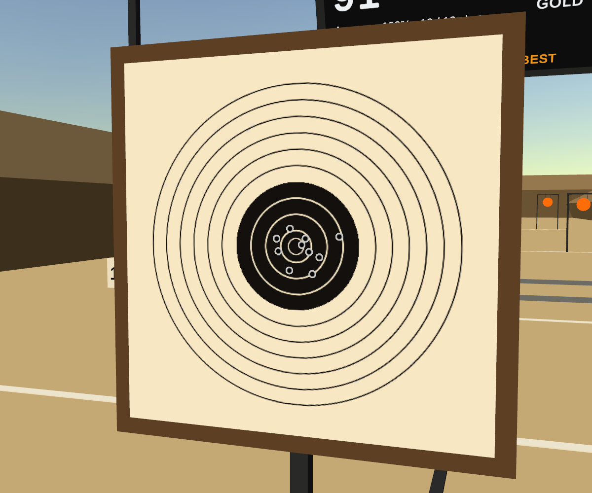 |

Shots, hits, accuracy and longest hit per gun, the top five scores per mode and tier and the best Precision group are saved between sessions as a versioned JSON file and shown on a records board in the booth. Progression is cosmetic only: nothing is ever locked.

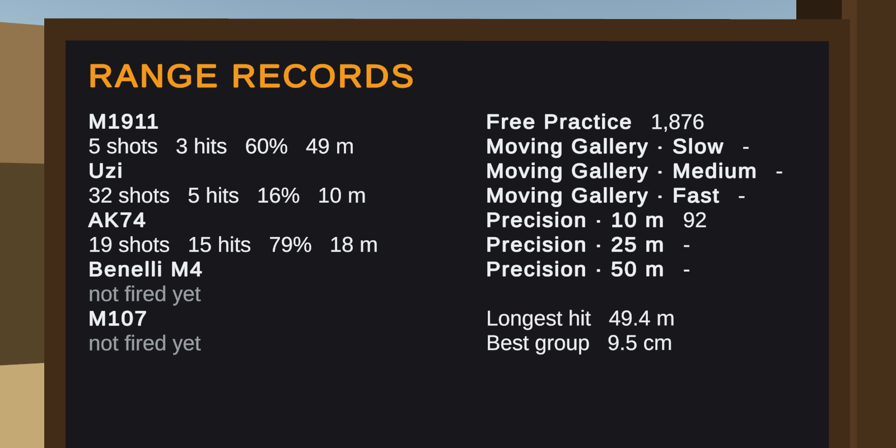

## Controls

| Input | Action |
| --- | --- |
| Grip | Pick up a gun or a magazine. A second hand on a long gun steadies it. |
| Trigger | Fire |
| B / Y on the gun hand | Drop the magazine, or reload if quick reload is on |
| A / X on the gun hand | Release a locked slide, or switch between single shots and automatic |
| Fingertip, or ray and trigger | Press panel buttons and sliders |
| Turn the left wrist toward you | Wrist menu: pause, settings, recenter, quit |

## Comfort and accessibility

- No locomotion, no camera shake, and nothing locked to the head. All UI lives in the world.
- **Seated mode** brings a seated player up to standing height, so the bench, rack and panel sit where their hands are.
- **Left-handed mode** swaps the rack and the panel to the other side. Either hand can hold any gun.
- **Quick reload** for anyone who would rather not handle magazines.
- **Ear protection**: put the earmuffs from the bench on your head and every sound is muffled, as on a real range.
- Master, gunshot and music volume, haptic strength from 0 to 100%, and an optional 45° snap turn.
- No-shoot targets are marked with an X shape as well as a colour, so they read without colour vision.
- The muzzle flash is skipped whenever the muzzle is within 30 cm of the eyes.

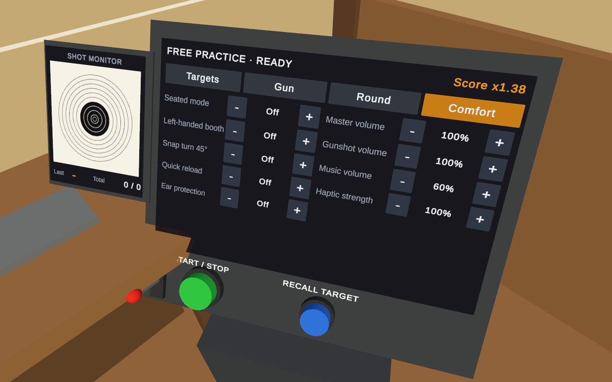

## Install on your headset

The game is not on the Meta Store, so you install the APK file directly (sideloading).

**You need:** a Meta Quest 3S, 3 or 2 with its controllers (it was built for the 3S), a USB-C cable and a computer.

1. Turn on developer mode for your headset in the Meta Horizon phone app (Menu → Devices → your headset → Headset settings → Developer mode). Meta asks you to register as a developer first, which is free.
2. Download `RangeControlVR-0.1.0.apk` from the [Releases page](https://github.com/Alihamxamalik/VR-Shooting-Range/releases/latest).
3. Connect the headset to your computer and accept the "Allow USB debugging" prompt inside the headset.
4. Install it with one of these:
   - [SideQuest](https://sidequestvr.com/setup-howto): drag the APK onto the SideQuest window.
   - [Meta Quest Developer Hub](https://developers.meta.com/horizon/documentation/unity/ts-mqdh/): drag the APK onto your device.
   - Command line: `adb install -r RangeControlVR-0.1.0.apk`
5. In the headset, open the app Library, change the filter to **Unknown sources**, and start **Range Control VR**.

The game has no internet permission and saves only your scores and settings, in files on the headset.

## About this build

- Version 0.1.0, package id `com.alihamza.rangecontrolvr`, built with IL2CPP for ARM64 with Vulkan. The APK is 42 MB.
- Signed with a debug key, which is normal for a file installed by hand and is not suitable for a store release.
- Checked in the Unity Editor: 130 automated tests pass, including ones that drive the VR hands through the same interaction code the headset uses. Grip positions, reach, haptics and frame rate still have to be tuned and measured on the headset itself.
- The gun models are from an Asset Store pack (see [Credits](#credits)). Everything else in the range is simple shapes, and every sound is generated in code.

SHA-256 of the APK: `1942abe0645f3288d7074178ec8e1f5878c499518a5616faac912cd4ec6ffc67`

## For developers

### Requirements

- Unity **6000.0.81f1** with the Android build module (OpenJDK, SDK and NDK)
- The packages restore themselves when the project opens: XR Interaction Toolkit 3.3.2, OpenXR 1.16.1, XR Management 4.5.4, Input System 1.19, URP 17.0.4
- [Low Poly Weapons VOL.1](https://assetstore.unity.com/packages/3d/props/guns/low-poly-weapons-vol-1-151980) from the Unity Asset Store (free). Asset Store files may not be republished, so they are not in this repository.

### Open and build

```bash
git clone https://github.com/Alihamxamalik/VR-Shooting-Range.git
```

1. Open the folder in Unity Hub.
2. Import Low Poly Weapons VOL.1 from the Package Manager (My Assets) and move its folder to `Assets/ThirdParty/Low Poly Weapons VOL.1`. Until then the guns work but have no models.
3. Open `Assets/_Project/Scenes/Range.unity` and press Play. The XR Interaction Simulator starts with it, so the game can be played with mouse and keyboard and no headset.
4. For the headset: **File → Build Profiles → Android → Build** makes the APK. **Tools → Range Control → Configure Project** sets the Quest player, rendering and OpenXR settings again if they are ever changed.

**Tools → Range Control → Build Everything** regenerates the materials, data assets, prefabs and the scene from code. It replaces `Range.unity`, so use it for a clean start, not after dressing the scene by hand.

### Project layout

```
Assets/_Project/
  Scripts/Core      events, hit interface, scoring, stats, round controller, pools
  Scripts/Weapons   weapon, recoil, haptics, hitscan, magazines and sockets, scope
  Scripts/Targets   targets, movement patterns, spawner, paper carrier
  Scripts/Range     settings, control panel, effects, booth layout
  Scripts/UI        scoreboard, shot monitor, popups, records board, tutorial, wrist menu
  Scripts/Editor    project setup and the builders that generate art, data, prefabs and the scene
  Data              ScriptableObject assets: guns, modes, settings, events
  Prefabs           guns, magazines, targets, effects (generated)
  Scenes            Range.unity (generated)
  Tests             edit-mode and play-mode tests
Docs/Screenshots    the images on this page
Tools/              make_audio.py, which writes every sound in the game
```

### How it is put together

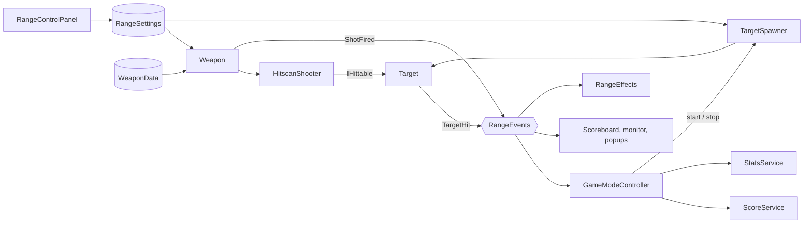

- **One settings asset, one hit interface, one event channel.** The panel only writes to [`RangeSettings`](Assets/_Project/Scripts/Range/RangeSettings.cs); the spawner, the carrier and the guns each react to it by themselves. The shooter only knows [`IHittable`](Assets/_Project/Scripts/Core/HitInfo.cs). Weapons, targets, scoring, effects and UI each hold a reference to the [`RangeEvents`](Assets/_Project/Scripts/Core/RangeEvents.cs) asset and never to each other, so nothing looks anything up at runtime.
- **Guns are data.** A new gun is a new [`WeaponData`](Assets/_Project/Scripts/Weapons/WeaponData.cs) asset plus a model. [`Weapon`](Assets/_Project/Scripts/Weapons/Weapon.cs) reads the trigger and runs the fire sequence; [recoil](Assets/_Project/Scripts/Weapons/WeaponRecoil.cs), [haptics](Assets/_Project/Scripts/Weapons/WeaponHaptics.cs) and [the shot](Assets/_Project/Scripts/Weapons/HitscanShooter.cs) are separate components.
- **Hits are a raycast; the tracer is only a picture.** A shot is resolved the instant it is fired, so nothing can tunnel through a thin target, and the streak the player sees is drawn afterwards from the result.
- **Nothing is created or destroyed during a round.** Targets, tracers, bullet holes, score popups, sounds and magazines come from [pools](Assets/_Project/Scripts/Core/PrefabPool.cs), and impact particles share one emitter per surface.
- **Movement patterns are stateless strategies.** Each [mover](Assets/_Project/Scripts/Targets/TargetMovers.cs) takes the speed every frame, which is why a panel change reaches a target that is already moving.
- **Rules are plain C#.** [Scoring](Assets/_Project/Scripts/Core/ScoreRules.cs), [the score for a round](Assets/_Project/Scripts/Core/ScoreService.cs), [trigger timing](Assets/_Project/Scripts/Weapons/FireController.cs) and [save files](Assets/_Project/Scripts/Core/StatsService.cs) have no scene dependencies, which is why they can have unit tests.
- **Reloading works with the toolkit, not around it.** The [magazine well](Assets/_Project/Scripts/Weapons/MagwellSocket.cs) is an XRI socket that takes a magazine as soon as it is pushed in, shuts for a moment after one comes out, and makes a seated magazine invisible to hands so that a hand reaching for the handguard gets the rifle.
- **The scene is generated.** Editor [builders](Assets/_Project/Scripts/Editor) create the materials, data assets, prefabs and the range itself from code, so the layout is reviewable as a diff and a fresh clone can rebuild it.

### Tests

Window → General → Test Runner → Run All, in both the EditMode and PlayMode tabs.

- **Edit mode (106):** the points table, combo and difficulty factor, medals, trigger hysteresis and rate of fire, spread, every movement pattern, panel limits and locking, and the stats file including a corrupt file and an interrupted save.
- **Play mode (24):** the real range scene with no headset. Sixteen aim a gun and pull its trigger from code, or work the panel, and check what follows: hits, reloads, shell loading, a full timed round, results, saved stats, presets and the comfort options. Eight drive the rig's own hands through XRI: a controller is moved to a gun and its grip pressed, the trigger is pulled through the hand's input, a second hand steadies a rifle, a magazine is taken from the belt and pushed into the well, the tray restocks, buttons are poked with a fingertip, and the first-launch walkthrough is played from start to finish.

The hand-driven tests are in [`HandInteractionTests.cs`](Assets/_Project/Tests/PlayMode/HandInteractionTests.cs).

### Performance budget

The targets the project is built to. The rendering rows are applied to the project settings by **Tools → Range Control → Configure Project**; none of it has been measured on the headset yet.

| | Budget for Quest 3S |
| --- | --- |
| Frame rate | 72 fps minimum, 90 fps target |
| Rendering | URP forward, 4x MSAA, no HDR, no post-processing, fixed foveated rendering, Vulkan, single-pass instanced |
| Lights and shadows | One directional light, no real-time shadows |
| Garbage during a round | 0 B per frame |
| Scope | 512 x 512, rendered only while the eye is at the lens |

## Roadmap

- A tuning pass on the headset: grip positions, reach, haptics and the wrist menu are set from the models and need hands on them.
- Profiler captures on Quest 3S against the budget above.
- Baked lighting and a dressed booth in place of the blockout.
- Recorded audio in place of the synthesised placeholders, and shell casings.
- Steel Challenge, Reaction and Clays modes.

## Credits

Built with [Unity](https://unity.com), the [XR Interaction Toolkit](https://docs.unity3d.com/Packages/com.unity.xr.interaction.toolkit@3.3/manual/index.html) and [OpenXR](https://www.khronos.org/openxr/). Gun models: [Low Poly Weapons VOL.1](https://assetstore.unity.com/packages/3d/props/guns/low-poly-weapons-vol-1-151980) by Simon Mercuzot.

Every third-party asset, its licence and whether it is in this repository is listed in [CREDITS.md](CREDITS.md).

## Licence

Copyright © 2026 Ali Hamza. All rights reserved. The app may be downloaded and run for evaluation, and the source code is published for reference.
